<p align="center">
  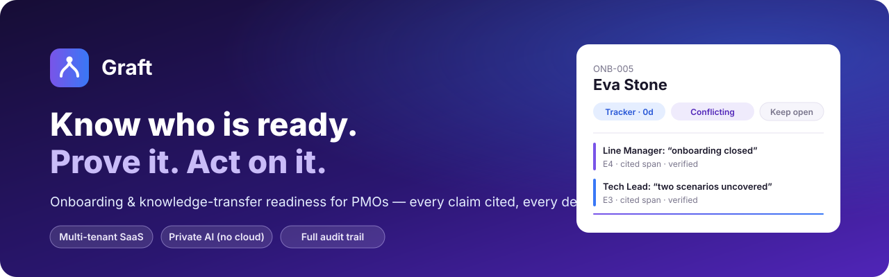
</p>

<p align="center">
  <a href="https://graft-560i.onrender.com/"></a>
  <a href="#run-it-in-two-minutes"></a>
  <a href="AGENT_SPEC.md"></a>
  <a href="docs/eval.md"></a>
</p>

<p align="center">
  
  
  
  
  
  
</p>

<h3 align="center"><a href="https://graft-560i.onrender.com/">Try the live demo → graft-560i.onrender.com</a></h3>

<p align="center"><b>Team K · Engineering Albania Student Hackathon 2026</b></p>

---

> **Graft answers one question for every new joiner, transfer and handover:**
> ### *What evidence shows this person can actually work independently — and who acts next?*

Onboarding status today lives in a spreadsheet column that someone typed weeks ago. Graft replaces that guess with
**evidence**: it reads the emails, updates, tracker notes and documents your teams already produce, extracts
**cited** claims with a private AI model, flags where reports disagree, routes a follow-up to a named owner, and lets the
**technical owner** — never the AI — record the readiness decision. Every step is permission-checked, audited and
survives a refresh.

<br>

## Contents

- [Why companies choose Graft](#why-companies-choose-graft)
- [How it works](#how-it-works)
- [See it in 3 minutes — the Eva Stone story](#see-it-in-3-minutes--the-eva-stone-story)
- [Product tour](#product-tour)
- [The trust layer](#the-trust-layer-ai-proposes-people-decide)
- [Roles, responsibilities and visibility](#roles-responsibilities-and-visibility)
- [Plans](#plans)
- [Run it in two minutes](#run-it-in-two-minutes)
- [Architecture](#architecture)
- [Team and task split](#team-and-task-split)
- [Roadmap](#roadmap)

<br>

## Why companies choose Graft

| The problem today | What Graft does |
| --- | --- |
| *"The tracker says Ready."* A status is one person's opinion, often stale. | Shows the tracker as **one report among others, with its age**, next to the evidence that supports or contradicts it. |
| Line manager says *closed*, tech lead says *two scenarios still uncovered* — on the same day. Nobody notices. | **Conflict rules** catch contradictory reports automatically and raise a finding with both citations. |
| Access was *requested*, so everyone assumes it *works*. | Tracks **requested → approved → active → confirmed usable**. Only the employee's own successful test counts. |
| Follow-ups get lost in chat threads. | Every finding becomes an **owned task** with due date, SLA, queue, reassignment history and reminders. |
| AI tools hallucinate and decide things they shouldn't. | AI only **proposes**. Every quote is verified against the original text; invented text is rejected and shown as rejected. |
| Employee data can't leave the company. | Runs a **private model** (Ollama) on your network. No hosted inference, no data sent to third parties. |
| Auditors ask *"who decided this, and based on what?"* | Every write is an **audit event** with actor, before/after and citations. Reviews are append-only. |

<table>
<tr>
<td width="25%" align="center"><br><br><b>Faster time-to-productive</b><br><sub>Blockers surface the day they appear, not at the monthly status meeting.</sub></td>
<td width="25%" align="center"><br><br><b>Decisions you can defend</b><br><sub>Every readiness call links to the exact sentence that justified it.</sub></td>
<td width="25%" align="center"><br><br><b>Private by design</b><br><sub>Multi-tenant isolation, role-scoped views, on-prem AI, OIDC SSO.</sub></td>
<td width="25%" align="center"><br><br><b>Fits your process</b><br><sub>Templates, configurable thresholds, CSV import, inbound relay.</sub></td>
</tr>
</table>

<br>

## How it works

<p align="center">
  
</p>

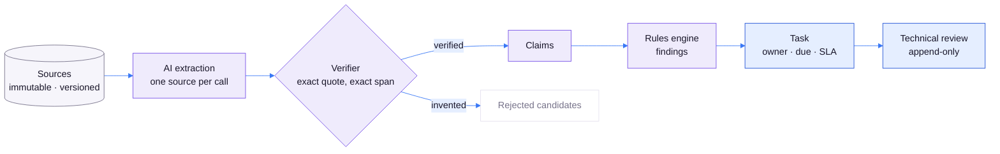

**Three data classes, three write paths.** Evidence is never edited (a correction is a new version). Derived data —
claims and findings — is recomputable at any time. Human data — tasks and reviews — is written only by people through
their own API routes. A test guarantees that re-running analysis never changes, duplicates or deletes a task or review.

### The readiness journey

A case's stage is derived from the **latest technical review**, never from the tracker. Training completed is not the
same as being able to execute, and shadowing is not supported execution.

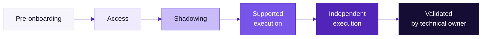

### Access is four states, not one checkbox

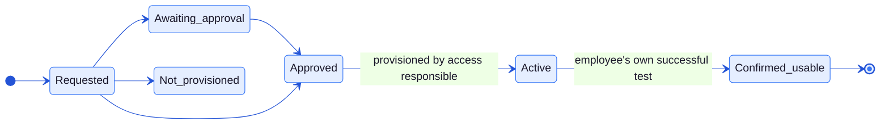

<br>

## See it in 3 minutes — the Eva Stone story

> **Live demo: https://graft-560i.onrender.com/** — sign in at
> [/login](https://graft-560i.onrender.com/login). Every demo account is a fictional person; the sign-in page shows the
> shared demo password.

> **Demo data.** The organisers' starter pack (`data/seed.json`, ONB-001 to ONB-010, verbatim) plus our showcase dataset
> (`data/showcase.json`, ONB-011 to ONB-026): a signed-off case, a reopened sign-off, blocked access, a stale tracker, a closure conflict, an
> unanswered request, an HR document upload, paused and reassigned tasks, a training log and ambiguous inbox mail.
> The showcase is replayed through the real API as fictional users on first start (`SEED_SHOWCASE=true`, the default),
> with recorded extractions so it shows verified claims without a model. Eva's case is never touched.

| Step | Who | What you see |
| :---: | --- | --- |
| **1** | **Elira Dervishi** · PMO Coordinator | Insights shows the portfolio mid-quarter: **26 cases, 17 needing attention**, every chart populated. |
| **2** | Elira | Open **ONB-005 Eva Stone**. Tracker: *Ready with Support*. Evidence pill: **Conflicting reports** — the Line Manager (E4) reports closure while the Technical Lead (E3) reports two uncovered complex scenarios, same day. Each claim highlights its exact span in the original; one invented candidate sits in *Rejected*. |
| **3** | Elira | **Assign** the flag to Ardit Kola with a due date. Try to record a review yourself: refused (403) — coordinators coordinate, they don't sign off. |
| **4** | **Ardit Kola** · Technical Owner | Open ONB-005 → **Record technical review** → *Keep open*, scope *Overall onboarding*, linked to the task. |
| **5** | Anyone | Hard refresh: everything is there. Run **Analyze evidence** twice: the task and the review are untouched. |

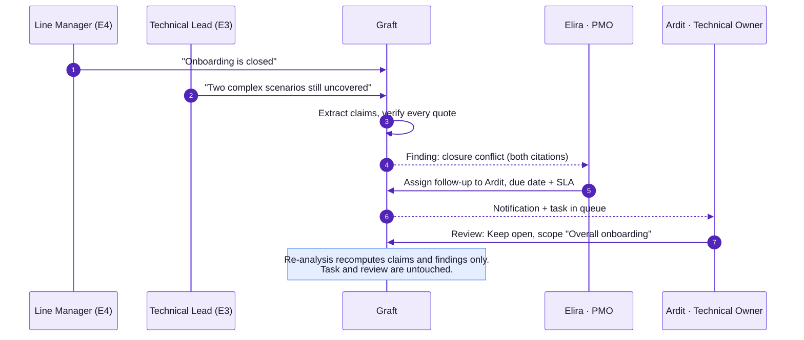

<details>
<summary><b>Second walkthrough — from new hire to sign-off</b></summary>

1. As **Elira**, Cases → **New case**: "Dina Kraja", project transfer, Nimbus, line manager Luca Gray. The
   project-transfer template is snapshotted: Nadia (Nimbus technical owner) and Besa (Nimbus training default) get
   their milestone tasks; handover and access tasks land in the **coordinator queue** (Queues → Unowned).
2. Reassign the access task to **Gent Morina** with a reason; the history shows queued → reassigned.
3. As **Nadia**, open the case → Evidence → **Add evidence**, then **Record decision**: try **Final sign-off** first
   (refused, listing the milestones not yet validated), then **Validated for scope** per milestone, then the
   sign-off with a citation. Readiness reads *Signed off*; the tracker status stays a separate report.
4. Cases → **Import CSV** previews rows with errors and duplicates; importing the same file twice creates nothing new.

</details>

<details>
<summary><b>More things to try</b></summary>

- **Gent Morina** → ONB-002: access-only view; can approve access but cannot confirm usability.
- **Teuta Gjoni** (HR): summary view, no review rationale.
- **Klea Hoxha** → Projects → Orion → Team.
- **Dren Basha** → Settings → People & Roles.
- **Ardit Kola** → switch the working context in the user menu: Home and Ask Graft re-focus, permissions don't change.
- **Sam Rivera** (Sandbox Co) → a second tenant. Nothing from the first org is reachable; it's a 404, not a 403.

</details>

<br>

## Product tour

| Module | What it gives you |
| --- | --- |
| **Home** | A role-aware work queue: what *you* need to act on today. |
| **Cases** | Saved views — *needs attention, mine, stale, access blocked, all* — with reasons and next task per row. Record page with three separate pills: **Tracker report · Evidence · Technical review**. Tabs for Overview, Evidence, Timeline, Access and Knowledge. |
| **Projects** | Project teams and default responsibilities that cases inherit (overrides never mutate the project). |
| **Inbox** | Paste text or upload a PDF, Word file, text file or scan. Graft auto-matches it to a case, extracts claims and refreshes findings. |
| **Tasks & Queues** | Owned follow-ups with SLA, claim / reassign / pause / resume, full history and overdue reminders. |
| **Knowledge** | References to where project docs live (never copies), with owner and last-verified date. |
| **Ask Graft** | Questions about a case or the portfolio, answered only from data you may see, every statement cited. Refuses when nothing supports an answer. |
| **Insights & Metrics** | Charts for reasons, severity, project, stage, tracker age, access states, workload and due dates — each with a table view of the same numbers. Outcome metrics with drill-down and scoped CSV export. |
| **Settings** | Rules & AI thresholds, People & Roles, versioned AI guidance, audit trail. |

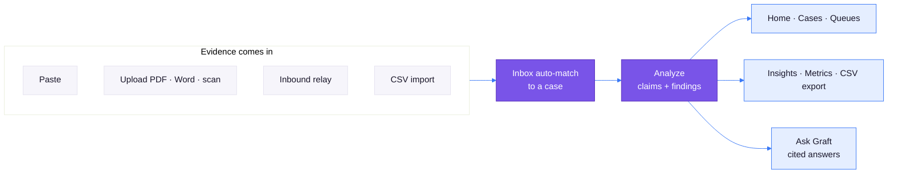

**Documents:** PDF, `.docx`, UTF-8 text and scans (PNG, JPEG, TIFF, scanned PDFs via Tesseract OCR). File type is
detected from the bytes, text is extracted on the server, and the original file is **not stored** — only its name, type,
size, SHA-256, method and page count. Limits: 10 MB, 30 pages, 20,000 characters per source.

<br>

## The trust layer: AI proposes, people decide

| Guarantee | How it's enforced |
| --- | --- |
| **No invented evidence** | Output is schema-constrained. The verifier requires each quote to appear **exactly once** in the immutable body and asserts `body[start:end] == quote`. Failures go to *rejected candidates* and never feed rules or the UI evidence list. |
| **AI never decides readiness** | Readiness = observed execution + technical-owner validation. `backend/app/ai/` has **no import path** to task or review writers — a test enforces it. |
| **Bounded agents** | The case agent uses read-only tools, max 8 tool calls, a time budget, one run per case. It runs *as the requesting user*, so it can never see more than they can. Every proposal must cite real claim or source ids. |
| **Human handoff** | *Accept* opens the normal task form pre-filled (origin `ai_suggested_edited`); *Dismiss* records a reason. Both are audited. |
| **Prompt-injection safe** | Source bodies are data inside tool results, never instructions. Ask Graft refuses instruction changes, private matters and judging people before any model call. |
| **Transparent modes** | Every AI output shows its mode badge (**Live · Verified cache · Recorded example · Unavailable**), model, prompt version and a click-to-source citation. |
| **Works without AI** | `ai_enabled=false` or no model → originals stay visible; manual tasks and reviews keep working; background jobs resume when the model returns. |
| **Measured, not marketed** | [`docs/eval.md`](docs/eval.md) publishes every live run against the business fixtures — failures included. |

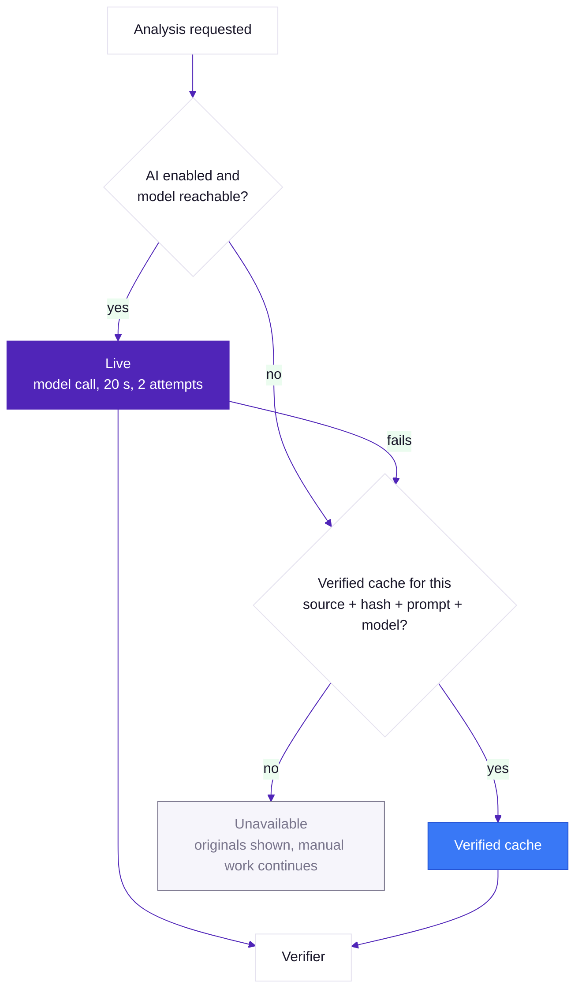

### Tested, not promised

150 backend tests guard the guarantees above, grouped here by what they protect:

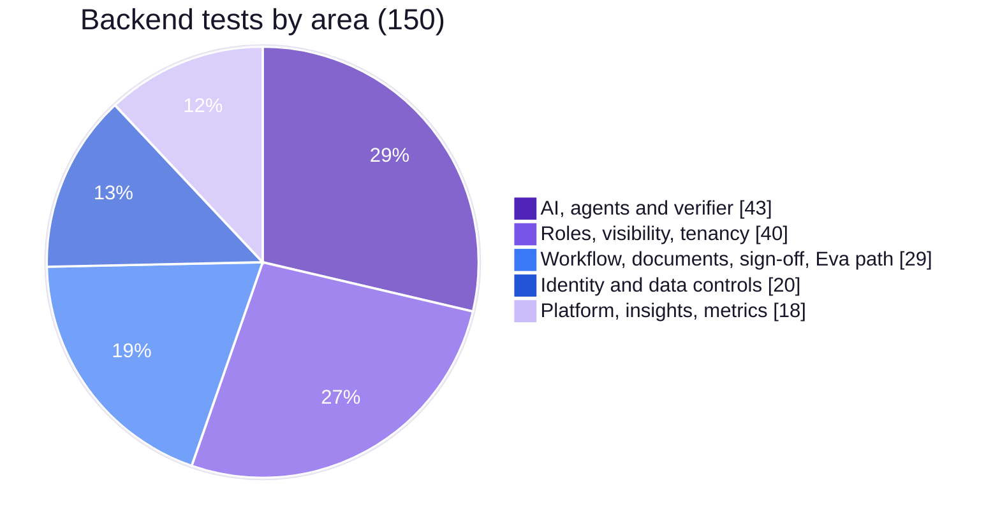

<br>

## Roles, responsibilities and visibility

A person can hold several roles, each granted at **organization**, **project** or **case** scope. **Roles** decide what
you may do; **responsibilities** say who is accountable on a specific case; **AI preferences** only change how the
assistant presents things. The three are stored and enforced separately — and a hidden case is a 404, exactly like
another tenant's.

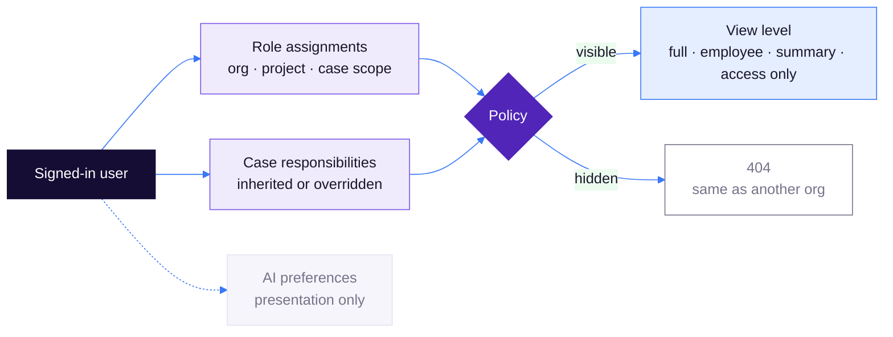

| Role | Sees | Can do |
| --- | --- | --- |
| Organization Admin | Everything in the org | Settings, people and role grants, demo reset |
| PMO Coordinator | Every case | Assign responsibilities and follow-ups, analyze evidence, run the case agent, AI guidance |
| Project Manager | Cases in their projects | Project team, responsibilities and follow-ups |
| Line Manager | Their direct reports | Follow-ups for their reports |
| **Technical Owner** | Their projects' or assigned cases | **The readiness review**, when primary technical owner on the case |
| Training Responsible | Assigned cases | Training & KT log. Never signs off readiness |
| HR Business Partner | Their cohort, summary only | HR follow-ups; no technical assessment notes |
| Access Responsible | Access items on assigned cases | Requested → approved → active; cannot confirm usability |
| Project Member | Project cases, summary only | Their own tasks |
| Employee | Their own case | Their tasks; confirm their own access works |
| Management Viewer / Auditor | Summaries (auditor: full audit trail) | Read-only |

<details>
<summary><b>Demo accounts</b> (fictional people)</summary>

Sign in at [graft-560i.onrender.com/login](https://graft-560i.onrender.com/login) with
`firstname.lastname@demo.graft.example` (Sandbox Co: `sam.rivera@sandbox.graft.example`) and the shared demo password
shown on the sign-in page. Passwords are salted scrypt hashes, attempts are throttled, and password sign-in exists only
for demo orgs in demo mode. Production orgs sign in with OIDC SSO.

| Person | Roles and scope |
| --- | --- |
| Dren Basha | Organization Admin |
| Elira Dervishi | PMO Coordinator |
| Klea Hoxha | Project Manager · Orion, Atlas |
| Ardit Kola | Technical Owner · Orion, Aurora, Atlas; Training Responsible · Orion |
| Nadia Ferri | Technical Owner · Nimbus, Helios, Nova, Pulse, Vega |
| Besa Leka | Training Responsible · Aurora, Nimbus |
| Luca Gray | Line Manager of Eva (ONB-005); Project Member · Orion |
| Teuta Gjoni | HR Business Partner for ONB-002 and ONB-005 |
| Gent Morina | Access Responsible for Leo's systems (ONB-002) |
| Erion Daci | Project Member · Orion |
| Eva Stone, Leo Marin | Employees (ONB-005, ONB-002) |
| Mira Shehu | Management Viewer |
| Ilir Prifti | Auditor |
| Sam Rivera | Admin of the second tenant, *Sandbox Co* |

</details>

<br>

## Plans

<table>
<tr>
<td width="33%" valign="top">
<h3>Pilot</h3>
<b>Free</b><br><br>
One project team · demo data · up to 25 onboarding cases
</td>
<td width="33%" valign="top">
<h3>Team · recommended</h3>
<b>€6 / employee case / month</b><br><br>
Unlimited projects · AI evidence extraction · full audit trail
</td>
<td width="33%" valign="top">
<h3>Enterprise</h3>
<b>Contact us</b><br><br>
OIDC SSO · private model on your network · data residency · custom retention and integrations
</td>
</tr>
</table>

<sub>Indicative pricing for the prototype. Nothing is billed.</sub>

<br>

## Run it in two minutes

Don't want to install anything? Use the **[live demo](https://graft-560i.onrender.com/)**.

**Docker (app + Postgres 16)**

```bash
docker compose up --build
```

- App: http://localhost:8000/ (sign in at `/login`) · Health: http://localhost:8000/api/health
- Startup runs migrations and seeds the demo orgs once; it never deletes human records.
- Reset explicitly: `docker compose exec app python -m app.seed.seed --reset` (or user menu → *Reset demo data* as admin).

**Local development (hot reload)**

```bash
cd backend && python -m venv .venv && source .venv/bin/activate   # Windows: .venv\Scripts\activate
pip install -r requirements.txt && alembic upgrade head
uvicorn app.main:app --reload                                      # :8000
```

```bash
cd frontend && npm install && npm run dev                          # :5173, proxies /api → :8000
```

**Tests and build**

```bash
cd backend && pytest -q
```

```bash
cd frontend && npm run build
```

**Other entry points:** worker `python -m app.worker` · operator CLI `python -m app.ops --help` ·
eval `python -m eval.run_eval --mode replay|live`.

Configuration is via environment variables — see [`.env.example`](.env.example). No secrets are committed.

### Deployment profiles

| Profile | Command | AI | Identity |
| --- | --- | --- | --- |
| **Hosted demo** ([live](https://graft-560i.onrender.com/)) | Render → New → Blueprint → this repo (`render.yaml`) | Recorded examples; live AI via a tunnel ([guide](docs/deployment.md#live-ai-on-the-hosted-demo-tunnel-fictional-data-only)) | Demo accounts |
| **Local demo** | `docker compose up` | Recorded examples | Demo accounts |
| **Private** | `docker compose --profile private up -d` | Local Ollama on an internal network, pinned model digest | OIDC SSO |

Model provisioning and pinning, identity, backups and release gates: [`docs/deployment.md`](docs/deployment.md).

<br>

## Architecture

One Docker image, one origin, no CORS.

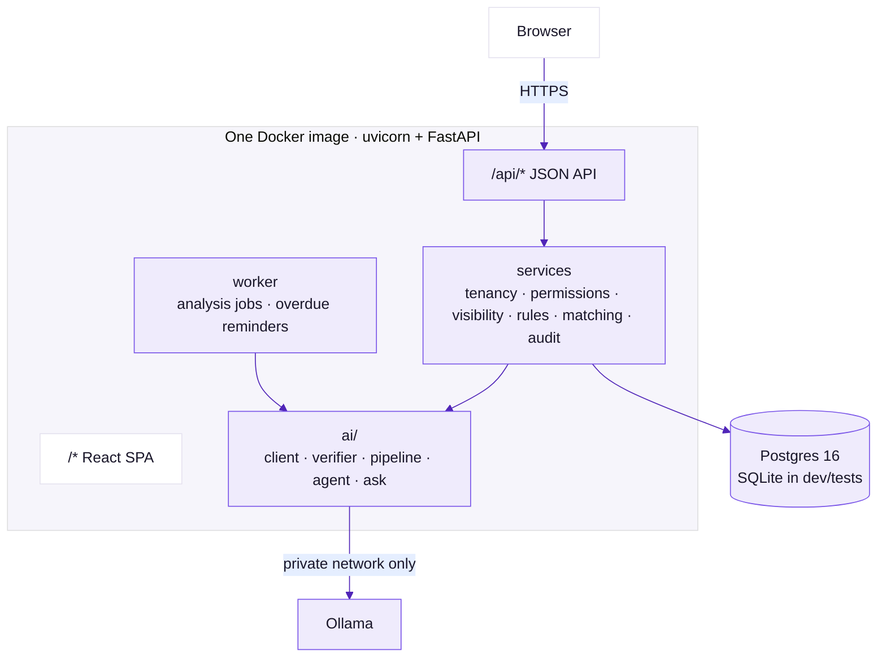

| Path | What |
| --- | --- |
| `backend/app/api/` | One router per API group |
| `backend/app/services/` | Tenancy, permissions, visibility, rules, matching, audit, timeline |
| `backend/app/ai/` | The trust layer — the only place a model is called |
| `backend/app/models/`, `schemas/` | SQLAlchemy models and the Pydantic API contract |
| `backend/alembic/` | Migrations |
| `backend/tests/` | Unit and acceptance tests (Eva path, tenancy, visibility per role, AI boundaries) |
| `backend/eval/` | Evaluation harness and recorded results |
| `frontend/src/site/` | Public pages: landing, pricing, login |
| `frontend/src/app/` | The authenticated app |
| `frontend/src/lib/` | Typed API client and TanStack Query hooks |
| `data/seed.json` | Starter-pack cases and evidence, verbatim |
| `Dockerfile`, `docker-compose.yml`, `render.yaml`, `.github/workflows/ci.yml` | Build, deploy, CI |

Deeper reading: [`docs/architecture.md`](docs/architecture.md) · [`docs/business-rules.md`](docs/business-rules.md) ·
[`AGENT_SPEC.md`](AGENT_SPEC.md) · [`docs/eval.md`](docs/eval.md).

**Non-negotiables:** every tenant table has `org_id NOT NULL` and every query goes through scoped helpers; role comes
from the session, never the request body; every write emits an audit event in the same transaction; no real data and
no credentials in git.

<br>

## Team and task split

Each member works on their own `feat/<area>` branch, commits at least every 30 minutes, stays inside their owned paths,
and merges through small PRs into `main`. **Blevis** is the single merger.

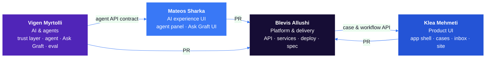

| Member | Focus | Owns these paths |
| --- | --- | --- |
| **Blevis Allushi** | **Platform, delivery, specification** — deploy, merging, hardening, business-owner checkpoint, business rules, agent spec, architecture doc, final PR | `backend/app/api/` (except `agents.py`, `ask.py`), `backend/app/services/`, `backend/app/models/` (except `agent.py`), `Dockerfile`, `render.yaml`, `.github/`, `AGENT_SPEC.md`, `docs/business-rules.md`, `docs/architecture.md`, `backend/eval/fixtures/` |
| **Vigen Myrtolli** | **AI and agents** — live model runs, the case agent (loop, tools, tables, endpoints), Ask Graft, eval harness and measured results | `backend/app/ai/`, `backend/app/models/agent.py`, `backend/app/api/agents.py`, `backend/app/api/ask.py`, the agent migration, `backend/eval/` (except `fixtures/`), `docs/eval.md`, `backend/tests/test_agent*.py`, `backend/tests/test_ask*.py` |
| **Mateos Sharka** | **AI experience UI** — agent panel on the case page, Ask Graft on the case page and Home, trace and proposal accept/dismiss | `frontend/src/app/cases/AiPanel.tsx`, `frontend/src/app/ask/`, agent/ask hooks and types in `frontend/src/lib/` |
| **Klea Mehmeti** | **Product UI** — role-specific views, case and inbox polish, readiness date and role fields, layout, empty states, public site | `frontend/src/app/` (except `cases/AiPanel.tsx` and `ask/`), `frontend/src/site/`, `frontend/src/components/` |

**Shared files** (`frontend/src/lib/api.ts`, `frontend/src/lib/types.ts`, `backend/app/main.py`,
`backend/app/api/__init__.py`): append only, small commits, announce in the team chat.

### Task board

| Phase | Blevis · Platform | Vigen · AI | Mateos · AI UI | Klea · Product UI |
| --- | --- | --- | --- | --- |
| **0 · Kick-off**<br><sub>14:00–14:30</sub> | Book the business-owner checkpoint; commit `AGENT_SPEC.md`; confirm CI is green | Agree the agent API contract with Mateos | Agree the agent API contract with Vigen | Run the app, sign in as each role |
| **1 · Go live**<br><sub>14:30–16:30</sub> | Render Blueprint live (done); walk Eva path on prod; run checkpoint → `docs/business-rules.md` | Live extraction on E1–E8; agent tables, migration, loop and endpoints with a stubbed model | Agent panel against a mocked response | Employee and line-manager experience; access confirmation; empty states |
| **2 · Make it real**<br><sub>16:30–19:00</sub> | Apply checkpoint answers to rules and settings; readiness date and role (API + migration); production hardening; rewrite `AGENT_SPEC.md` to match code | Agent end to end on Eva, Leo, Lina; Ask Graft; eval harness over the fixtures | Switch panel to real API; Ask Graft box on case page and Home | Readiness date and role in the case header; coordinator edit form; checklist wiring |
| **3 · Evidence**<br><sub>19:00–20:15 · <b>freeze</b></sub> | `docs/architecture.md`; measured numbers into the spec; merge, test, build, redeploy | Commit a measured eval run including at least one failure | Click-through of every page as every role on prod | Click-through of every page as every role on prod |
| **4 · Hand-in**<br><sub>20:15–21:45</sub> | Open the submission PR with judge and mentor as reviewers; clean-clone README check | Bug fixes only | Bug fixes only | Bug fixes only |

> **Last commit pushed by 21:45.** Commits after 22:00 do not count.

<details>
<summary><b>Agent API contract</b> (Vigen builds, Mateos consumes — frozen after 15:00)</summary>

- `POST /api/cases/{id}/agent-runs` → `{id, case_id, status, assessment, proposals[], steps[], model, prompt_version, created_at}`
  - `status`: `completed | failed | unavailable`
  - proposal: `{id, kind: task|message|access_followup, title, body, owner_role, owner_user_id, due_date, cited_source_ids[], cited_claim_ids[], status: open|accepted|dismissed, dismiss_reason}`
  - step: `{index, tool, arguments, result_summary, duration_ms}`
- `GET /api/cases/{id}/agent-runs` → past runs, newest first
- `POST /api/agent-proposals/{id}/dismiss {reason}`
- Accept: normal `POST /api/cases/{id}/tasks` with `origin: "ai_suggested_edited"` and `proposal_id`
- `POST /api/ask {question, case_id?, focus?, detail?, format?}` → `{answer, citations[{source_id, claim_id, quote}], refused, mode, model, prompt_version, presentation}`

</details>

<details>
<summary><b>Risks and fallbacks</b></summary>

| Risk | Fallback |
| --- | --- |
| Model down or busy | Intake and manual work continue; jobs wait and resume; verified cache or recorded examples are served meanwhile. |
| Agent work runs late | Cut order: triage agent → Ask Graft → agent on Leo/Lina. Minimum: Eva agent run, panel, spec section. |
| Render outage | Local `docker compose up`. |
| Business owner contradicts a rule | Thresholds are org settings; each rule is one tested function in `services/rules.py`. |
| Late merge conflicts | Separate owned paths, small PRs, one merger (Blevis), freeze at 20:15. |
| A secret lands in git | Keys live only in `.env` and Render; `.env*` is gitignored. Rotate immediately if leaked. |

</details>

<br>

## Roadmap

### Hackathon day at a glance

```mermaid
%%{init: {"theme":"base","themeVariables":{"fontFamily":"Inter, Segoe UI, sans-serif","primaryTextColor":"#191629","taskBkgColor":"#7954E8","taskBorderColor":"#5025B8","taskTextColor":"#FFFFFF","taskTextLightColor":"#FFFFFF","taskTextOutsideColor":"#191629","activeTaskBkgColor":"#3978F6","activeTaskBorderColor":"#2454D6","doneTaskBkgColor":"#C9BCF8","doneTaskBorderColor":"#7954E8","critBkgColor":"#160D35","critBorderColor":"#160D35","sectionBkgColor":"#EFEBFC","altSectionBkgColor":"#F6F5FB","sectionBkgColor2":"#E5EEFF","gridColor":"#E5E2EF","todayLineColor":"#2454D6"}}}%%
gantt
    title Team K · Day 1 (14:00 – 22:00)
    dateFormat HH:mm
    axisFormat %H:%M
    todayMarker off
    section Blevis · Platform
    Kick-off         :a0, 14:00, 30m
    Render live      :done, a1, after a0, 60m
    Checkpoint       :a2, after a1, 60m
    Rules + hardening :a3, 16:30, 150m
    Merge + redeploy :a4, 19:00, 75m
    Submission PR    :crit, a5, 20:15, 90m
    section Vigen · AI
    Contract         :b0, 14:00, 30m
    Extraction + agent loop :b1, 14:30, 120m
    Agent + Ask Graft :b2, 16:30, 150m
    Eval run         :b3, 19:00, 75m
    Bug fixes        :crit, b4, 20:15, 90m
    section Mateos · AI UI
    Contract         :c0, 14:00, 30m
    Panel on mock    :c1, 14:30, 120m
    Real API + Ask UI :c2, 16:30, 150m
    Click-through    :c3, 19:00, 75m
    Bug fixes        :crit, c4, 20:15, 90m
    section Klea · Product UI
    Kick-off         :d0, 14:00, 30m
    Role views       :d1, 14:30, 120m
    Case header + forms :d2, 16:30, 150m
    Click-through    :d3, 19:00, 75m
    Bug fixes        :crit, d4, 20:15, 90m
    section Milestones
    Contract frozen                      :milestone, m0, 15:00, 0m
    Feature freeze                       :milestone, m1, 20:15, 0m
    Last push                            :milestone, m2, 21:45, 0m
    Hard deadline                        :milestone, m3, 22:00, 0m
```

### What shipped, phase by phase

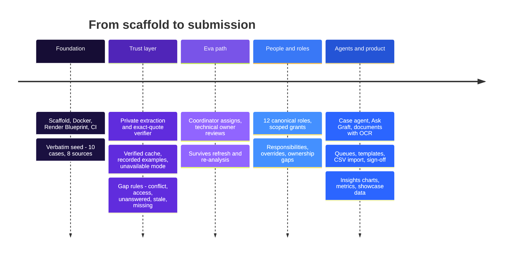

### Where the effort went

Every phase was planned against the judging weights:

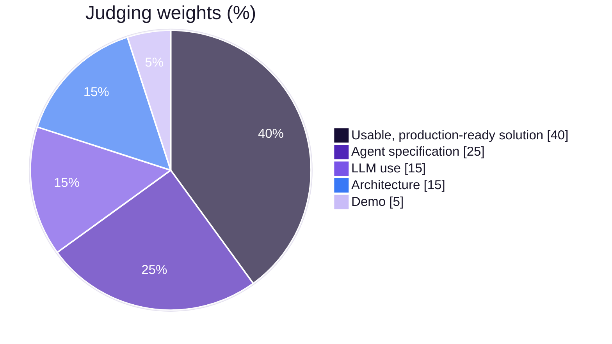

### Shipped

- [x] Multi-tenant data layer, seeded verbatim from the starter pack, plus a 16-case showcase dataset replayed through the API
- [x] Gap rules: closure conflict, access not confirmed, unanswered request, stale tracker, missing fields
- [x] Trust layer: schema-constrained private extraction, exact-quote verifier, verified cache, recorded examples, unavailable mode
- [x] AI task drafting, labelled *AI suggestion · not saved*, saved only by a human
- [x] Eva path end to end — survives refresh and re-analysis
- [x] 12 canonical roles with org / project / case scope, responsibilities with project defaults and overrides, ownership gaps
- [x] Case agent, Ask Graft, document upload with OCR, queues, templates, CSV import, outcome metrics, audit trail
- [x] Insights and Home charts, each with a table view of the same numbers
- [x] 150 backend tests: Eva path, tenancy, visibility per role, role checks, verifier, AI boundaries

<br>

---

<p align="center">
  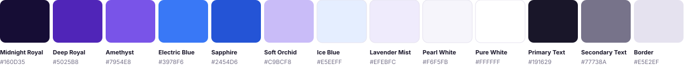
</p>

<p align="center">
  <b><a href="https://graft-560i.onrender.com/">graft-560i.onrender.com</a></b><br>
  <sub><b>Graft</b> · Team K · Engineering Albania Student Hackathon 2026 · All data is fictional.</sub>
</p>
